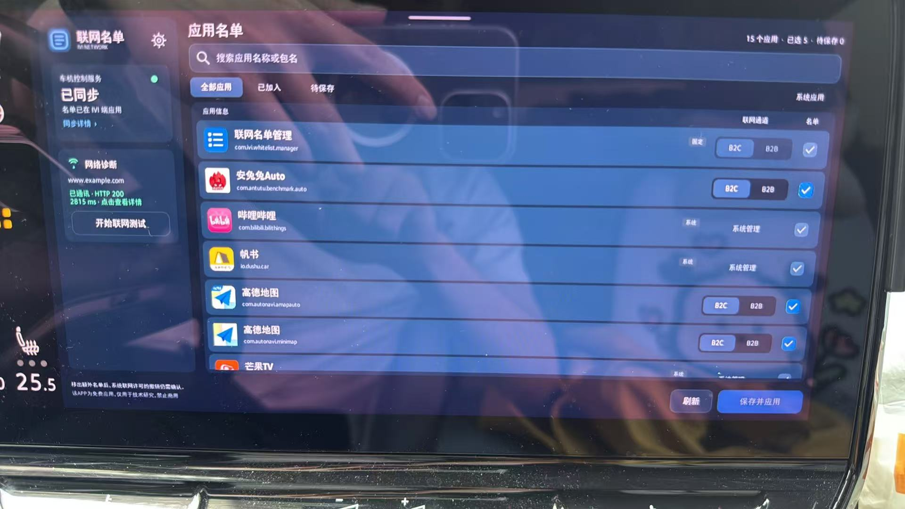
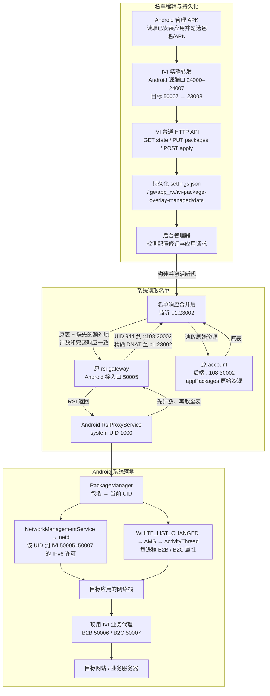
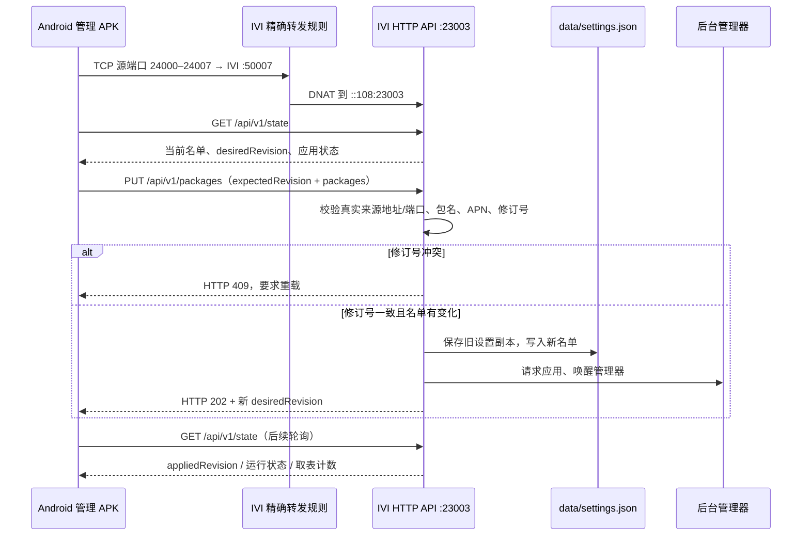
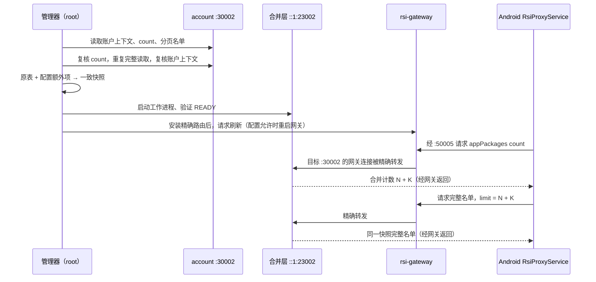
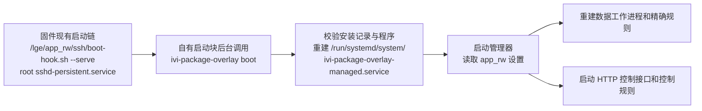
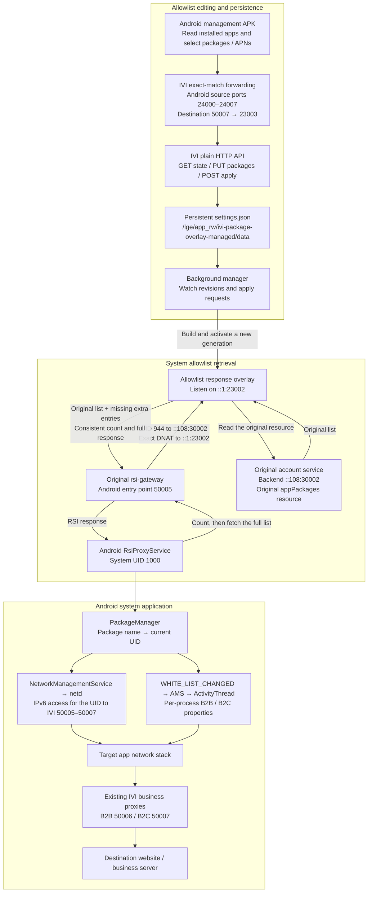
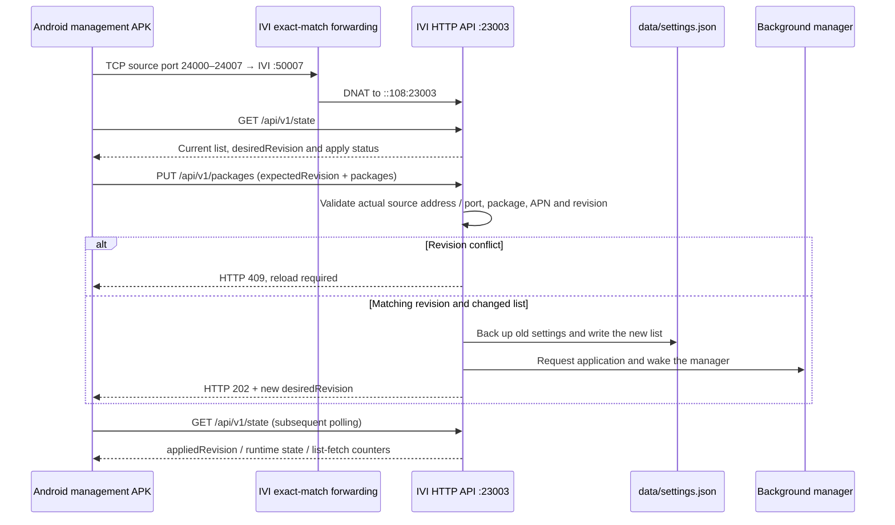
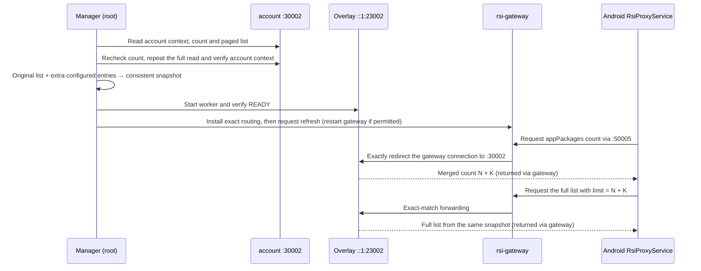
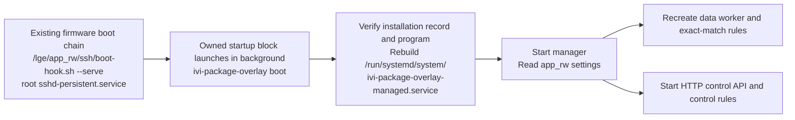

# IVI Whitelist Manager · 联网名单管理

在车机 Android 上管理应用联网名单，配合 IVI Linux 后端保存并应用 B2C / B2B 配置。

Manage application network allowlists on an Android head unit, with an IVI Linux backend that saves and applies B2C / B2B settings.

[中文](#中文) · [English](#english) · [工作原理](#工作原理) · [Architecture](#architecture)

## 界面示例 / App preview



## 中文

### 功能

- 读取当前 Android 用户已安装应用的名称、图标和包名。
- 按应用名称或包名搜索，筛选全部应用、已加入和待保存项，切换系统应用显示。
- 为额外名单中的应用选择 B2C 或 B2B，批量“保存并应用”。
- 保留系统原名单和管理端自身，防止在界面中误删。
- 查看连接状态、保存修订、IVI 应用修订和 Android 取表计数。
- 普通刷新保留未保存的选择，并发修改冲突时提示重载；长按“刷新”可请求重新应用。
- 通过管理 APP 自身测试 HTTP / HTTPS 网站连通性，支持自定义测试网址。

### 工作原理

以下图示对应 Android APK **1.1.0** 与 IVI 后端 **2026-11-12-v7-android-control**。箭头表示请求、响应或逻辑调用，不一定代表独立的 TCP 连接。图示描述通信与软件流程，实际运行状态通过 `status` 和 Android 侧验证确认。

图中的 `::99`、`::108` 分别简写 Android 地址 `fd53:7cb8:383:3::99` 和 IVI 地址 `fd53:7cb8:383:3::108`；`::1` 指 IVI 的 IPv6 回环地址。网关 UID `944` 为配套固件中的观测值，程序运行时通过服务 / 进程信息核对。

#### 1. 总体关系



管理 APK 以普通应用 UID 读取已安装应用信息并编辑额外名单；固件原有 `RsiProxyService` 负责消费名单、解析包名对应 UID，并配置系统网络许可和应用进程的 B2B / B2C 属性。

#### 2. 名单保存与修订校验



管理接口仅提供 `GET /api/v1/state`、`PUT /api/v1/packages` 和 `POST /api/v1/apply`。保存时携带 `expectedRevision`，修订冲突返回 HTTP 409；保存成功后的期望修订与系统实际生效是不同阶段。管理 APK 自身保留在 B2C 名单，原系统名单在响应合并时保留。

#### 3. 名单合并与系统取表



原始名单来自 account 的 `/colorservicemanagement/appPackages/` 资源。管理器核对账户上下文、分页前后计数及两次完整读取的内容摘要后，构建一致快照。原表 N 项加上实际缺失的 K 项，合并总数为 N + K；已有项不重复加入，APN 冲突阻止应用，失败后保留设置并定期重试。

数据转发位于 IVI IPv6 `nat OUTPUT`，仅匹配网关 UID、目标 `::108` 和 TCP `30002`，DNAT 至 `[::1]:23002`。管理器和合并工作进程使用其他 UID 读取源表，避免转发回自身。合并层仅重写精确匹配的名单计数 / 完整请求；其他请求透传，原 `rsi-gateway` 与 `account` 二进制保持原样。

#### 4. 持久化与开机恢复



固定安装程序位于 `/lge/app_rw/ivi-package-overlay-managed/ivi-package-overlay-linux-arm64`。持久化目录中的 `settings.json` 保存名单与期望配置，`install.json` 保存安装身份与校验信息，`generations/` 保存分代快照及事务记录；`/run/systemd/system/ivi-package-overlay-managed.service` 是每次开机由持久化入口恢复的临时单元。

`autostartConfigured` / `bootEnabled` 表示启动入口已配置；实际重启恢复仍需在目标设备验证。

#### 5. 端口与生效边界

| 端口 / 范围 | 位置 | 用途 |
| --- | --- | --- |
| TCP `50005` | IVI `::108` | 原 RSI 网关入口，供 Android 系统读取名单及账户资源 |
| TCP `30002` | IVI `::108` | account 原始资源后端，Android 不直接通过此端口取表 |
| TCP `23002` | IVI `::1` | 名单合并层，接收网关精确转发的后端流量 |
| TCP `50006` | IVI `::108` | 现用 B2B 业务代理 |
| TCP `50007` | IVI `::108` | 现用 B2C 业务代理；指定来源及源端口的管理连接转至 `23003` |
| TCP `24000–24007` | Android 源端口 | 管理 APK 控制连接使用的源端口池 |
| TCP `23003` | IVI `::108` | 普通 HTTP 控制 API |

控制转发通过 `nat PREROUTING` 将匹配来源的 `50007` 请求转至 `23003`，配套 `filter INPUT` / `filter OUTPUT` 规则允许请求及回复；安装与清理按精确元组和自有记录处理。

Android 落地包含两条链：`NetworkManagementService → netd` 配置 UID 到 IVI `50005–50007` 的 IPv6 许可；`WHITE_LIST_CHANGED → AMS → ActivityThread` 更新进程的 B2B / B2C 属性，供定制 Java `DefaultProxySelector` 选择业务代理。native 网络栈仍需自身支持代理，目标站点策略、DNS 和外网路由由对应组件决定。

保存成功、工作进程 `READY`、网关收到计数 / 完整响应和目标应用实际联网分别对应不同阶段。名单任务与控制任务独立运行，取表失败不能直接解释控制任务停止；从额外名单移除条目也不等于立即撤销 Android 既有 UID 许可。

### 环境要求

| 环境 | 要求 |
| --- | --- |
| IVI Linux | ARM64 / AArch64；具备 root shell，以及配套固件中的 RSI、account、服务与 IPv6 网络规则环境 |
| 持久化与自启 | `/lge/app_rw` 可写，已有固件调用的 `/lge/app_rw/ssh/boot-hook.sh` root 启动链 |
| 车机 Android | Android 5.0 / API 21 及以上；APK 的 targetSdk 为 28；以普通应用 UID 运行，无需 Android root |
| 内部网络 | Android 与 IVI Linux 之间具备配套内部 IPv6 通道，默认 IVI 地址为 `fd53:7cb8:383:3::108` |
| 安装工具 | 使用现有 SSH / 文件传输通道部署后端；电脑安装 Android Platform Tools，能够通过 ADB 访问车机 Android |

本发布包适用于上述车机环境。其他固件的路径、服务或网络布局可能不同，需要先核对兼容性。

### 部署

#### 1. 上传 Linux 后端

在 **IVI Linux root shell** 中创建发布目录：

```sh
mkdir -p /lge/app_rw/ivi-whitelist-manager-release
```

通过现有文件传输通道，将 `ivi-package-overlay-linux-arm64` 和 `rollback.sh` 上传到该目录。两个文件应放在同一目录，供回滚脚本定位后端。

#### 2. 启用后端与管理接口

继续在 **IVI Linux root shell** 中执行：

```sh
cd /lge/app_rw/ivi-whitelist-manager-release
chmod 700 ivi-package-overlay-linux-arm64
./ivi-package-overlay-linux-arm64 start --autostart --control
./ivi-package-overlay-linux-arm64 status
```

`start` 保留当前设置，并预先加入管理 APK 包名 `com.ivi.whitelist.manager`；`--autostart` 配置自启，`--control` 启用 Android 管理通道。

检查状态中的 `runtime.state` 为 `RUNNING`、`control.state` 为 `READY`。这表示 Linux 运行时与控制接口已就绪；Android 取表和实际联网需在安装 APK 后继续确认。

托管数据与配置保存在 `/lge/app_rw/ivi-package-overlay-managed/data`。后端通过 `/lge/app_rw/ssh/boot-hook.sh` 的 root `--serve` 分支自启。

#### 3. 安装 Android APP

在**电脑终端**中，进入 APK 所在目录，确认 ADB 连接的是车机 Android，再执行：

```sh
adb devices
adb install -r ivi-whitelist-manager-1.1.0.apk
adb shell am start -n com.ivi.whitelist.manager/.MainActivity
```

如同时连接多台 Android 设备，为每条 ADB 命令指定 `-s SERIAL`。`install -r` 用于安装或覆盖升级；升级现有 APP 时需保持签名兼容。

APP 默认连接 `fd53:7cb8:383:3::108`。地址不同时，打开“连接与测试设置”，填写对应的内部 IPv6 地址，不要填写 HTTP URL。

首次安装后的正常 `PACKAGE_ADDED` / RSI 刷新链负责管理端 UID 准入；将包名加入后端名单与 Android 完成 UID 准入是两个阶段。

#### 4. 确认部署结果

1. APP 能读取车机状态与应用名单。
2. 勾选一个额外应用、选择 B2C / B2B，点击“保存并应用”。
3. 在同步详情中确认保存修订与 IVI 应用修订一致，观察 Android 取表计数。
4. 使用“联网测试”确认管理 APP 的本次请求结果，再在目标应用中验证实际业务联网。
5. 需要自启时，重启车机后再次检查 Linux 状态与 APP 连接。

### 名单与配置

| 界面选项 | 后端值 |
| --- | --- |
| B2C | `Business2Customer` |
| B2B | `Business2Business` |

名单按应用包名保存。系统原名单和管理端自身保持保留；普通刷新不会覆盖未保存的选择。若出现并发修改冲突，先记录本地修改，再使用“重载”读取车机最新名单后重新编辑。

从额外名单中移除应用，不代表 Android 已实时撤销既有 UID allow。实际撤销与断网结果需要在目标系统和应用中另外确认。

日常增删名单可直接通过 APP 完成，无需手动编辑配置。[config.sample.json](config.sample.json) 展示底层配置格式，其中包含 `com.autonavi.amapauto` 的 B2C 示例条目；它不是当前运行配置的导出文件，默认部署无需导入。

### 连接与联网测试

| 通道 | 地址 / 端口 | 用途 |
| --- | --- | --- |
| APP 管理连接 | Android 源端口 `24000–24007` → IVI `50007` | 普通 HTTP 管理请求，经专用规则转入控制 API |
| Linux 控制 API | `23003` | 状态查询、名单保存、重新应用；校验真实 socket 来源地址与端口 |
| APP 联网测试 | 普通源端口 → IVI B2C 代理 `50007` → 目标网站 | 验证管理 APP 自身的单次 HTTP / HTTPS 请求 |

管理通道仅为 Android 内部 IPv6 地址发来的专用源端口连接设置转发，保留原 HTTP 网关二进制和普通代理路径。控制通道使用普通 HTTP，没有 TLS、密码、配对或应用级身份认证；来源地址与端口检查不等同于应用身份认证。

“联网测试”默认访问 `https://www.example.com/`。在“连接与测试设置”中可保存域名或完整 HTTP / HTTPS 网址；裸域名自动补全为 HTTPS。

点击测试结果文字，可查看网址、HTTP 状态码、耗时、已读取字节及错误信息。测试不自动跟随重定向，最多读取 4096 字节；HTTP 4xx / 5xx 响应与传输失败分别显示。HTTPS 使用 Android 系统证书及主机名校验。

测试结果仅代表管理 APP 自身的本次 B2C 请求，不代表其他应用 UID 或 B2B 通道的联网结果，也不等同于名单控制接口可用。

### 常见问题

| 现象 | 检查与处理 |
| --- | --- |
| APP 无法连接 | 在 Linux 执行 `status`，确认 `RUNNING` / `READY`，已通过 `--control` 启用管理接口，并核对 APP 中的内部 IPv6 地址 |
| 首次安装后仍无法管理 | 核对正常安装触发的 `PACKAGE_ADDED` / RSI 刷新链，以及管理端 UID 准入情况 |
| 提示专用端口暂忙 | 稍后重试；控制连接在 `24000–24007` 中轮换绑定源端口 |
| 返回 HTTP 403 | 请求未通过预期的 Android 专用控制通道；检查来源地址、源端口和配套转发规则 |
| 返回 HTTP 409 或提示名单变化 | 先记录未保存修改，再重载车机名单并重新编辑、保存 |
| 已保存但尚未同步 | 查看保存修订、应用修订及错误详情；需要时长按“刷新”请求重新应用 |
| 管理接口正常但联网测试失败 | 查看测试详情中的状态码、错误和目标网址，单独检查普通 B2C 代理与目标站点连通性 |
| 移出名单后应用仍能联网 | 检查 Android 既有 UID allow 的撤销情况，不以名单移除作为实时断网证明 |

### 停用、卸载与回滚

以下 Linux 命令均在 **IVI Linux root shell**、发布目录中执行。

仅关闭管理接口及其控制规则：

```sh
./ivi-package-overlay-linux-arm64 control-off
```

卸载 Linux 托管后端：

```sh
./ivi-package-overlay-linux-arm64 uninstall
```

也可以通过同目录回滚脚本执行回滚：

```sh
sh rollback.sh
```

`uninstall` 与 `rollback.sh` 是两种清理入口，按需选择。卸载 / 回滚清理本工具创建的数据转发规则、控制规则和 SSH 启动块，保留当前设置与备份。

如需卸载 Android APP，在**电脑终端**执行：

```sh
adb uninstall com.ivi.whitelist.manager
```

仅卸载 APK 不会代替 Linux 后端的卸载；上述 Linux 清理也不会自动卸载 APK。

### 发布说明与验证范围

本仓库分发预编译 APK、Linux 后端、配置示例与回滚脚本，不包含源码、构建工具链、签名私钥或联调脚本。APK 清单声明版本 `1.1.0`、versionCode `2`、minSdk `21`、targetSdk `28`；Linux 后端为静态链接的 ARM64 可执行文件。

当前发布说明不代表已完成实车验收。Android 界面、真实车机自启、IPv6 转发、UID 准入及目标应用实际联网仍需在目标设备确认。包内没有额外的迁移或独立修复脚本。

APP 内声明：免费应用，仅用于技术研究，禁止商用。

## English

### Features

- List the names, icons and package names of apps installed for the current Android user.
- Search by name or package, filter all / added / pending apps, and toggle system app visibility.
- Select B2C or B2B for additional entries, then save and apply changes in a batch.
- Preserve the original system allowlist and the management app itself.
- Inspect connection status, saved and applied revisions, and Android list-fetch counters.
- Keep unsaved selections during a normal refresh and detect concurrent changes; long-press **刷新** (Refresh) to request reapplication.
- Test HTTP / HTTPS connectivity from the management app, with a configurable destination.

The current APK uses Chinese UI labels; the English instructions below include those labels where needed.

### Architecture

These diagrams cover Android APK **1.1.0** and IVI backend **2026-11-12-v7-android-control**. Arrows represent requests, responses or logical calls, and do not necessarily represent separate TCP connections. Check actual runtime behavior with `status` and Android-side verification.

`::99` and `::108` abbreviate the Android address `fd53:7cb8:383:3::99` and IVI address `fd53:7cb8:383:3::108`; `::1` is the IVI IPv6 loopback address. Gateway UID `944` was observed on the paired firmware; the program verifies service / process information at runtime.

#### 1. Overall flow



The management APK runs under a regular app UID to list installed apps and edit additional entries. The firmware's existing `RsiProxyService` consumes the list, resolves package names to UIDs, and configures system network access and per-process B2B / B2C properties.

#### 2. Saving changes and checking revisions



The management API exposes only `GET /api/v1/state`, `PUT /api/v1/packages` and `POST /api/v1/apply`. Saves include `expectedRevision`; conflicts return HTTP 409. Persisting a desired revision and applying it in Android are separate stages. The management APK remains in the B2C list, and response merging preserves original system entries.

#### 3. Merging and retrieving the system list



The original list comes from account's `/colorservicemanagement/appPackages/` resource. The manager verifies account context, counts before and after paging, and content digests from two complete reads before building a consistent snapshot. An original list of N entries plus K actually missing additions yields N + K entries. Existing entries are not duplicated, APN conflicts prevent application, and failures preserve settings for periodic retries.

Data forwarding uses IVI IPv6 `nat OUTPUT`, matching only the gateway UID, destination `::108` and TCP `30002`, with DNAT to `[::1]:23002`. The manager and overlay worker read the source under other UIDs to avoid looping back into the overlay. Only exact list-count / full-list requests are rewritten; other requests pass through, and the original `rsi-gateway` and `account` binaries are retained.

#### 4. Persistence and boot recovery



The installed program resides at `/lge/app_rw/ivi-package-overlay-managed/ivi-package-overlay-linux-arm64`. In the persistent data directory, `settings.json` stores the list and desired configuration, `install.json` records installation identity and integrity metadata, and `generations/` stores snapshots and transaction records. `/run/systemd/system/ivi-package-overlay-managed.service` is a temporary unit restored by the persistent boot entry on each boot.

`autostartConfigured` / `bootEnabled` indicate that the startup entry is configured; verify actual recovery after a reboot on the target device.

#### 5. Ports and application stages

| Port / range | Location | Purpose |
| --- | --- | --- |
| TCP `50005` | IVI `::108` | Original RSI gateway entry for Android system list and account-resource requests |
| TCP `30002` | IVI `::108` | Original account backend; Android does not fetch the list directly from this port |
| TCP `23002` | IVI `::1` | Allowlist overlay receiving exactly redirected gateway traffic |
| TCP `50006` | IVI `::108` | Existing B2B business proxy |
| TCP `50007` | IVI `::108` | Existing B2C business proxy; management connections matching the source address and port are redirected to `23003` |
| TCP `24000–24007` | Android source ports | Management APK control connection source-port pool |
| TCP `23003` | IVI `::108` | Plain HTTP control API |

Control forwarding uses `nat PREROUTING` to redirect matching requests from `50007` to `23003`, with paired `filter INPUT` / `filter OUTPUT` rules for requests and replies. Installation and cleanup use exact tuples and ownership records.

Android applies two chains: `NetworkManagementService → netd` grants UID-based IPv6 access to IVI ports `50005–50007`; `WHITE_LIST_CHANGED → AMS → ActivityThread` updates process B2B / B2C properties for the customized Java `DefaultProxySelector`. Native network stacks need their own proxy support; destination policies, DNS and external routing remain the responsibility of their respective components.

A successful save, worker `READY`, gateway count / full-list responses and actual target-app connectivity represent separate stages. The list task and control task run independently, so a list-fetch failure alone does not explain a stopped control task. Removing an extra entry does not immediately revoke existing Android UID permissions.

### Requirements

| Environment | Requirement |
| --- | --- |
| IVI Linux | ARM64 / AArch64, a root shell, and the matching firmware's RSI, account, service and IPv6 firewall environment |
| Persistence and boot | Writable `/lge/app_rw` and an existing firmware-invoked root boot chain at `/lge/app_rw/ssh/boot-hook.sh` |
| Head-unit Android | Android 5.0 / API 21 or later; the APK targets API 28 and runs under a regular app UID without Android root |
| Internal network | The paired internal IPv6 path between Android and IVI Linux; default IVI address: `fd53:7cb8:383:3::108` |
| Installation tools | An existing SSH / file-transfer channel for the backend, plus Android Platform Tools on a computer with ADB access to the head unit |

This release is intended for the environment above. Check compatibility before using firmware with different paths, services or network layouts.

### Deployment

#### 1. Upload the Linux backend

Create a release directory in the **IVI Linux root shell**:

```sh
mkdir -p /lge/app_rw/ivi-whitelist-manager-release
```

Use your existing file-transfer channel to upload `ivi-package-overlay-linux-arm64` and `rollback.sh` into this directory. Keep both files together so the rollback wrapper can locate the backend.

#### 2. Enable the backend and management interface

Continue in the **IVI Linux root shell**:

```sh
cd /lge/app_rw/ivi-whitelist-manager-release
chmod 700 ivi-package-overlay-linux-arm64
./ivi-package-overlay-linux-arm64 start --autostart --control
./ivi-package-overlay-linux-arm64 status
```

`start` preserves existing settings and adds the management package, `com.ivi.whitelist.manager`, in advance. `--autostart` configures startup at boot; `--control` enables the Android management channel.

Check that `runtime.state` is `RUNNING` and `control.state` is `READY`. These indicate Linux runtime and control-interface readiness; confirm Android list retrieval and actual connectivity after installing the APK.

Managed data and configuration are stored under `/lge/app_rw/ivi-package-overlay-managed/data`. Startup uses the root `--serve` branch of `/lge/app_rw/ssh/boot-hook.sh`.

#### 3. Install the Android app

In a **computer terminal**, open the directory containing the APK. Confirm that ADB targets the head-unit Android system, then run:

```sh
adb devices
adb install -r ivi-whitelist-manager-1.1.0.apk
adb shell am start -n com.ivi.whitelist.manager/.MainActivity
```

If multiple devices are connected, add `-s SERIAL` to each ADB command. `install -r` installs or updates the app; an update requires a compatible signing identity.

The app connects to `fd53:7cb8:383:3::108` by default. For a different address, open **连接与测试设置** (Connection and test settings) and enter the internal IPv6 address, without an HTTP URL scheme.

The normal `PACKAGE_ADDED` / RSI refresh chain admits the management app's UID after first installation. Adding a package name to the backend list and admitting its Android UID are separate stages.

#### 4. Verify deployment

1. Confirm that the app can read the IVI state and application list.
2. Select an additional app and its B2C / B2B channel, then tap **保存并应用** (Save and apply).
3. Open the synchronization details, check that the saved and IVI-applied revisions match, and inspect Android list-fetch counters.
4. Run **联网测试** (Connectivity test) for the management app, then verify actual business traffic in the target app itself.
5. If boot startup is required, restart the head unit and check Linux status and the app connection again.

### Allowlist and configuration

| UI option | Backend value |
| --- | --- |
| B2C | `Business2Customer` |
| B2B | `Business2Business` |

Entries are stored by package name. Original system entries and the management app remain protected. A normal refresh preserves unsaved selections. On a concurrent-change conflict, record local changes before using **重载** (Reload), then edit the latest list and save again.

Removing an additional entry does not establish that Android has immediately revoked an existing UID allow. Verify revocation and the resulting network behavior separately on the target system and app.

Use the app for routine list changes. [config.sample.json](config.sample.json) illustrates the underlying configuration format and includes a B2C example for `com.autonavi.amapauto`. It is not an export of the active configuration and does not need to be imported for the default deployment.

### Connections and connectivity tests

| Channel | Address / ports | Purpose |
| --- | --- | --- |
| App management connection | Android source ports `24000–24007` → IVI `50007` | Plain HTTP management requests, redirected by dedicated rules to the control API |
| Linux control API | `23003` | State queries, list saves and reapplication; checks the actual socket source address and port |
| App connectivity test | Ordinary source port → IVI B2C proxy `50007` → destination website | A single HTTP / HTTPS request from the management app |

Management forwarding matches the dedicated source-port range from the internal Android IPv6 address. The original HTTP gateway binary and ordinary proxy path are retained. The control channel uses plain HTTP, with no TLS, password, pairing or application-level authentication. Source address and port checks do not authenticate an app's identity.

The default test destination is `https://www.example.com/`. Set a domain or full HTTP / HTTPS URL in **连接与测试设置**; a bare domain is prefixed with HTTPS.

Tap the result text to inspect the URL, HTTP status, elapsed time, bytes read and errors. The test does not automatically follow redirects and reads up to 4096 bytes. HTTP 4xx / 5xx responses are distinguished from transport failures. HTTPS uses Android's system certificate and hostname validation.

The result covers only this management app's B2C request. It does not establish connectivity for other UIDs, the B2B channel or the management API.

### Troubleshooting

| Symptom | Check / action |
| --- | --- |
| App cannot connect | Run `status` on Linux, check `RUNNING` / `READY`, confirm management was enabled with `--control`, and verify the app's internal IPv6 address |
| Management unavailable after first install | Check the normal `PACKAGE_ADDED` / RSI refresh chain and admission of the management app's UID |
| Dedicated ports temporarily busy | Retry shortly; control connections rotate through source ports `24000–24007` |
| HTTP 403 | The request did not use the expected Android control channel; check the source address, source port and paired forwarding rules |
| HTTP 409 or a list-change message | Record unsaved changes, reload the IVI list, then edit and save again |
| Saved changes remain unsynchronized | Inspect saved / applied revisions and error details; long-press **刷新** to request reapplication if needed |
| Management works but the connectivity test fails | Inspect the test status, error and URL, then check the ordinary B2C proxy and destination separately |
| A removed app still has network access | Check revocation of existing Android UID allows; list removal alone does not prove immediate disconnection |

### Disable, uninstall and rollback

Run the following Linux commands from the release directory in the **IVI Linux root shell**.

Disable only the management interface and its control rules:

```sh
./ivi-package-overlay-linux-arm64 control-off
```

Uninstall the managed Linux backend:

```sh
./ivi-package-overlay-linux-arm64 uninstall
```

Alternatively, use the rollback wrapper from the same directory:

```sh
sh rollback.sh
```

Choose `uninstall` or `rollback.sh` as appropriate. Uninstall / rollback removes this tool's data-forwarding rules, control rules and SSH startup block, while retaining current settings and backups.

To uninstall the Android app, run this in a **computer terminal**:

```sh
adb uninstall com.ivi.whitelist.manager
```

Uninstalling the APK does not uninstall the Linux backend. Linux cleanup does not automatically remove the APK either.

### Release notes and verification scope

This repository distributes prebuilt APK and Linux binaries, an example configuration and a rollback wrapper. Source code, the build toolchain, signing private keys and interoperability test scripts are not included. The APK manifest declares version `1.1.0`, versionCode `2`, minSdk `21` and targetSdk `28`; the Linux backend is a statically linked ARM64 executable.

This documentation does not establish completed head-unit acceptance testing. Verify the Android UI, real boot startup, IPv6 forwarding, UID admission and target-app connectivity on the intended device. No additional migration or standalone repair script is included.

The app states that it is free, for technical research only, and not for commercial use.
